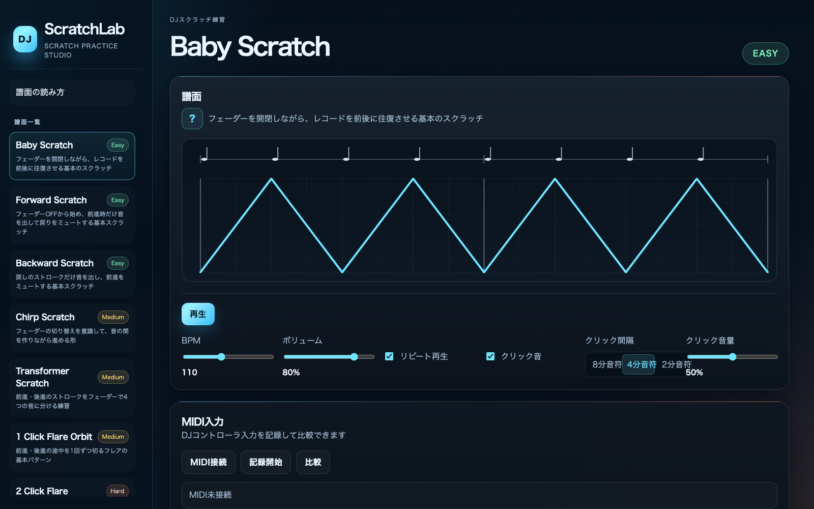
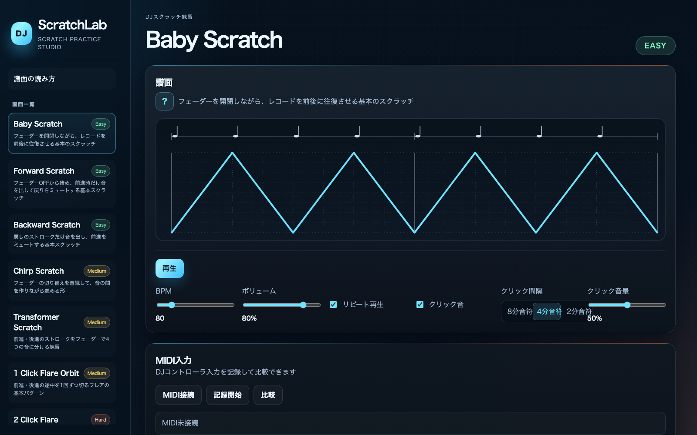
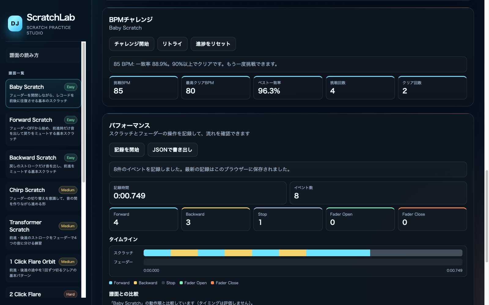
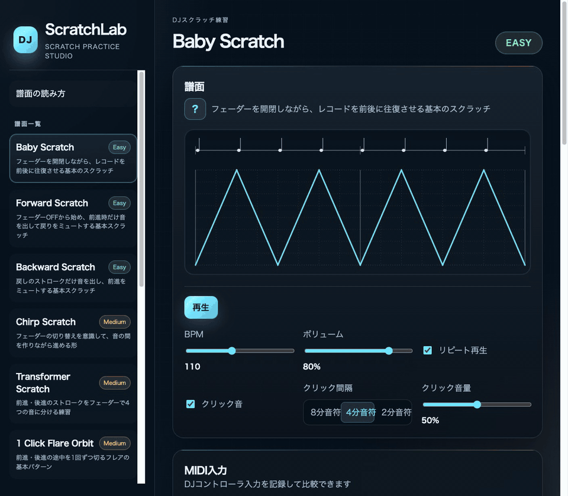
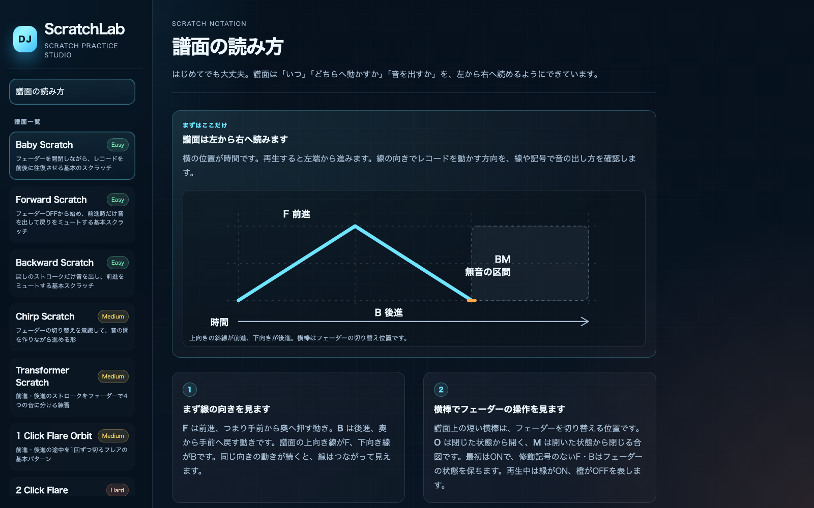
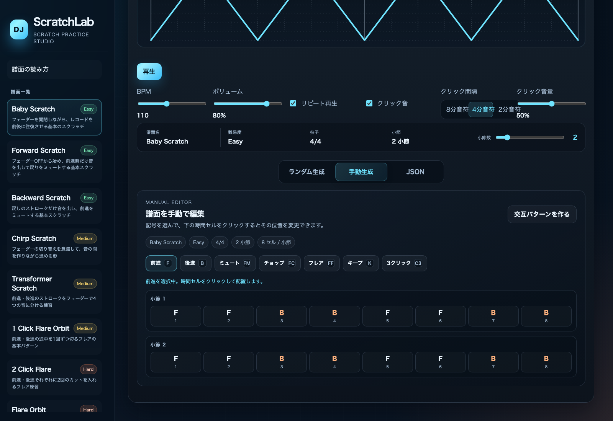
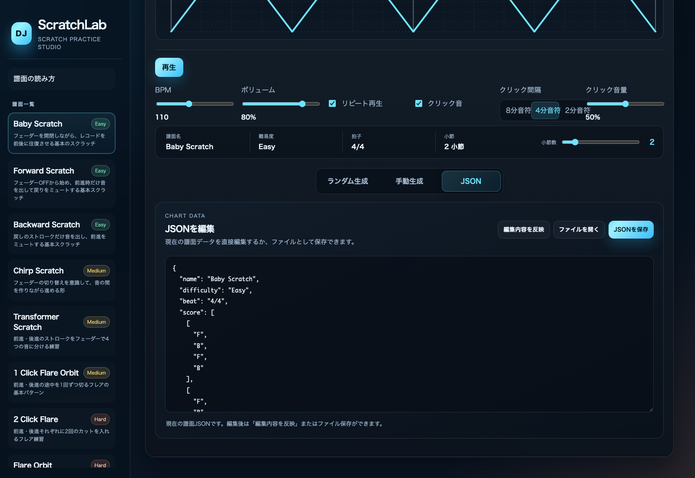
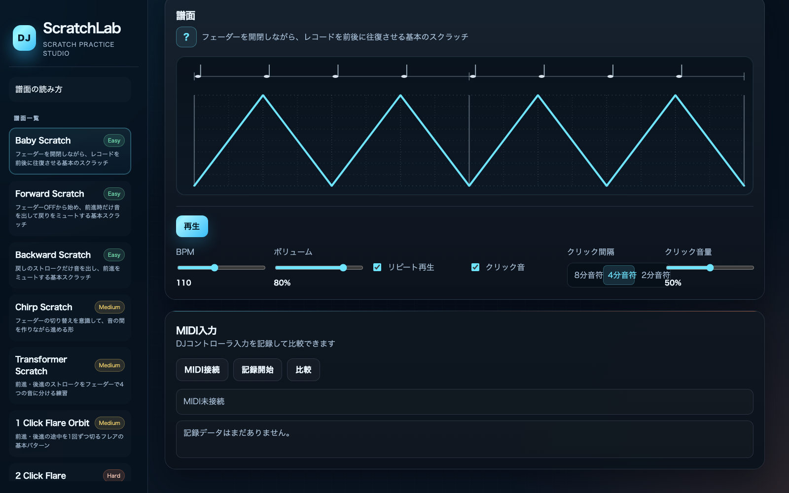

# ScratchLab

[](https://github.com/im-backgrounds/scratchlab/actions/workflows/deno-ci.yml)
[](https://github.com/im-backgrounds/scratchlab/actions/workflows/github-pages.yml)
[](LICENSE)

**ScratchLab
は、DJスクラッチの動きを譜面で見ながら、ブラウザー上で練習できる無料の練習アプリです。**

スクラッチは、レコードを前後に動かしながら、ミキサーのフェーダーで音を出したり止めたりしてリズムを作るDJの演奏方法です。ScratchLabでは、その動きや音の切り替えを譜面とサンプル音で確認できます。DJを始めたばかりの方も、基本の前進・後進から少しずつ練習できます。

ブラウザーですぐに試せます。練習を始めるだけなら、DJ機材やMIDI機器は必要ありません。

## ライブデモ

インストール不要で、次のURLからすぐに試せます。

**<https://im-backgrounds.github.io/scratchlab/>**

## こんな方におすすめ

- DJスクラッチをこれから始めたい方
- 基本の前進・後進やフェーダー操作を練習したい方
- パターンをゆっくり再生し、リズムや動きを確認したい方
- 練習パターンを自分で作ったり、MIDIコントローラーの入力を試したりしたい方

## 主な機能

- **練習用パターン** —
  初級から上級までの譜面を選び、動きの説明を見ながら練習できます。
- **譜面とサンプル再生** —
  レコードの前進・後進、音を出す区間やフェーダー操作を視覚的に確認できます。サンプル音はブラウザー内で生成します。
- **テンポとクリック音の調整** —
  BPM、音量、クリック音の有効・無効、間隔、音量を調整できます。
- **譜面作成** —
  譜面をランダム生成したり、セルを手動で編集したりできます。小節数や使用するテクニックも調整できます。
- **JSONの読み込み・保存** —
  譜面データをJSONとして読み込み、編集内容をファイルに保存できます。
- **ブラウザーへの保存と自動復元** —
  作った譜面をこのブラウザーに複数保存し、名前の変更や削除ができます。編集内容は自動で保存され、次回開いたときに前回の続きから再開できます（サーバーへの送信はありません）。
- **MIDI入力** —
  対応ブラウザーとMIDI機器があれば、「MIDIセットアップ」ページで接続と割り当てを行い、BPMチャレンジで演奏を自動記録・採点できます。機器なしでもアプリの練習機能は利用できます。

## はじめかた

機材なしでまず遊ぶ場合は、初回ガイド（「譜面の読み方」）の最後にある 「Baby
Scratchを試す」を押してください。Baby Scratchの譜面とBeginnerコースの
最初の課題が選ばれ、BPMチャレンジへ移動します。MIDI設定やコースのクリアは不要です。
右下の「練習モードを有効化」を押し、Wキーを押し続けながらマウスを上下に動かして
操作を試したら、「チャレンジ開始」で挑戦できます。ボタンを押すだけでは
練習モードの有効化やチャレンジ開始は行いません。

1. 左側の譜面一覧から、練習したいパターンを選びます。
2. 「譜面の読み方」を開き、譜面の線や記号の意味を確認します。
3. 「再生」を押して、クリック音と譜面の進み方を見ます。
4. 難しいと感じたらBPMを下げ、まずは前進・後進の向きに集中します。
5. 慣れてきたら、フェーダー操作やチョップ、フレアなどを含むパターンに進みます。
6. 実際のレコードやDJ機材がある場合は、画面の譜面に合わせて動きを練習します。

**記号の目安:** `F` は前進、`B` は後進です。`M` は音を止める区間、`C`
はチョップ、`F` 修飾はフレア、`K`
は音を出さずにつなぐ区間を表します。詳しい説明はアプリ内の「譜面の読み方」をご覧ください。

## スクリーンショット

### 1. 練習画面の全体像



左の一覧から譜面を選び、再生ボタンで練習を始めます。

### 2. テンポを調整する



最初はBPMを下げ、クリック音に合わせてゆっくり練習しましょう。

### 3. BPM Challenge



一致率90%以上でクリア。BPMを少しずつ上げながら練習できます。



デモ: 挑戦を開始 → 演奏を記録 → 一致率100%でクリア → 次は85 BPMに更新。

### 4. 譜面の読み方を知る



線の向きが前後の動き、横棒がフェーダーの操作を表します。

### 5. 自分でパターンを作る



記号を選んで時間セルをクリックするだけで、オリジナルの譜面を作れます。

### 6. 応用機能



譜面はJSONとして保存・読み込みできます。



DJコントローラーを接続すると、BPMチャレンジで演奏を記録して譜面と比較できます（画像は旧レイアウトのものです）。

## 操作・コントロール

### 練習画面

| 操作         | 内容                                             |
| ------------ | ------------------------------------------------ |
| 譜面一覧     | 練習するパターンを選択します。                   |
| 再生 / 停止  | 選択中の譜面を再生、または停止します。           |
| BPM          | 再生テンポを調整します。                         |
| ボリューム   | スクラッチサンプルの音量を調整します。           |
| リピート再生 | パターンを繰り返すかどうかを切り替えます。       |
| クリック音   | クリック音の有効・無効、間隔、音量を調整します。 |

### 譜面作成

- **ランダム生成:**
  難易度、細かさ、連符やシンコペーション、チョップ、フレア、キープの有無を選んで譜面を作ります。
- **手動生成:**
  記号を選び、編集する時間セルをクリックします。小節数も調整できます。
- **JSON:**
  譜面データを画面上で編集し、譜面へ反映したりJSONファイルとして保存したりできます。
- **保存済み:**
  「新しい譜面として保存」で現在の譜面をブラウザーに保存します。一覧から読み込み・名前の変更・削除ができ、保存した譜面を編集すると自動で更新されます。ブラウザーのデータを消去すると保存した譜面も消えるため、大切な譜面はJSONでも保存してください。
- **MIDI入力:**
  サイドバーの「MIDIセットアップ」ページで対応機器を接続します。受信したMIDIメッセージの診断表示もこのページにあります。練習画面にMIDIの操作ボタンはありません。利用にはWeb
  MIDIに対応するブラウザーと機器が必要です。
- **MIDIマッピング:**
  「MIDI接続」後、Forward・Backward・Faderの各行で「Learn」を押し、割り当てたいボタンやつまみを操作します。割り当てはブラウザーに保存されます。Learn中に、すでに別の操作へ割り当て済みの入力（同じボタン・チャンネル・ベロシティ）が来た場合は、既存の割り当てを変更せずにメッセージを表示し、Learnを続けます。
  - Forward/Backward: 学習したベロシティと一致したときだけ反応します。
  - Fader:
    1つのつまみで開・閉を判定します。「開の値〜閾値〜閉の値」を設定し、初期値は0・120・127です。開の値から閾値までが開、閾値を超えて閉の値までが閉です。「開閉を入れ替え」を押すと開と閉の値が入れ替わり、閾値は127−閾値になります。
  - Stop:
    割り当て不要です。Forward/Backwardが150ms入力されないと自動で停止と判定します。
  - 入力はスクラッチ／フェーダーのイベントに変換され、「受信イベント」（全件）に表示されます。コントローラーは1回のストロークで何百件ものメッセージを送るため、記録と採点には同じ方向・状態が続く間を1件にまとめた「パフォーマンスイベント」だけを使い、別のログに表示します（Stopの判定はそのままです）。ノートオン（ベロシティ1以上）とコントロールチェンジに対応しています。
- **パフォーマンス記録:**
  記録はBPMチャレンジが自動で開始・終了します（手動の記録ボタンはありません）。「パフォーマンス」パネルには最新の記録が表示されます。Forward・Backward・Stop・Fader
  Open・Fader
  Closeの回数、記録時間、イベントのタイムラインを表示します。「JSONで書き出し」でファイル保存でき、最新の記録はブラウザーに保存されて次回起動時に復元されます。選択中の譜面から期待される動作（前進・後進・フェーダーの開閉・最後の停止）を作り、記録と順番だけで比較して、一致・不足・余分の数と一致率（一致
  ÷
  (一致+不足+余分)）を表示します。スクラッチとフェーダーは別々に照合し、タイミングは評価しません。記録は2ループ分で、ループごとに照合して合算します。記録中に譜面を切り替えると記録は破棄されます。最大5000イベントまで記録します。
- **BPMチャレンジ:**
  練習画面の「BPMチャレンジ」で、選択中の組み込み譜面にBPMを上げながら挑戦します。「チャレンジ開始」を押すと、80
  BPM（クリア済みなら最高クリアBPM+5）に固定され、次の流れが自動で進みます。進行状況は「Demo
  / Recording 1/2 / Recording 2/2 / Analyzing /
  Result」で表示されます。手動で記録を開始・停止する必要はありません。
  1. Demo: お手本ループ（採点されません）
  2. Recording 1/2・2/2: 続く2ループを自動で記録
  3. 再生を自動停止し、記録を自動で判定して結果を表示
     挑戦中はBPMスライダーを変更できません。再生ボタンで止める、譜面やページを切り替えるとチャレンジは中断され、記録は破棄されます。入力には練習モードのマウス・キーボード、または「MIDIセットアップ」で接続・Forward/Backwardを割り当てたMIDI機器を使用します。2ループの一致率が90%以上でクリアとなり、次は+5
     BPMです。失敗した場合も、成功して次のBPMに進んだ場合も、同じ「チャレンジ開始」から始めます（失敗なら同じBPM、成功なら次のBPMに挑戦します）。リトライ専用のボタンはありません。挑戦BPMは保存せず、進捗（最高クリアBPM・挑戦回数・クリア回数・ベスト一致率・直近の結果）から求めます。進捗は譜面ごとにブラウザーへ保存され、「進捗をリセット」で消せます。保存していないビルダー譜面は対象外です。

練習モードではマウスの上下移動でスクラッチ、W/Pでフェーダー開、S/Lで閉、Escで練習モードを解除します。

## 開発者向け

### 必要なもの

- Python 3（ローカルHTTPサーバーの起動に使用）
- Deno 2（テストとフォーマット確認に使用）

アプリ本体はHTML、CSS、ネイティブJavaScript ES
Modulesで構成され、ビルド手順やnpm依存パッケージはありません。

### 起動

ワークスペースのルートで次を実行し、ブラウザーで <http://localhost:8000/>
を開きます。

```sh
python3 -m http.server 8000
```

### テスト・チェック

```sh
deno test --allow-read=tests/ui/snapshots
deno check src/app.js tests/domain/*.js tests/state/*.js tests/ui/*.js
deno fmt --check --unstable-component --ignore='tests/ui/snapshots/*.svg' .
deno lint src tests
git diff --check
```

Storage共通処理・Repositoryの失敗分岐は `tests/domain/`、
入力ログの保持・同期描画は `tests/ui/input-event-log_test.js` で確認します。
DOM表示や実機入力はブラウザーで別途確認してください。

GitHub Actionsでは、pushとpull
requestのたびにフォーマット確認、型チェック、テストを実行します。

### デプロイ

`main` ブランチへのpushのたびに、GitHub
Actions（`.github/workflows/github-pages.yml`）がリポジトリルートをそのままGitHub
Pagesへ公開します。ビルド手順はありません。初回のみ、リポジトリの Settings →
Pages → Build and deployment → Source を **GitHub Actions**
に設定してください。手動で再デプロイする場合は、Actionsタブから「GitHub
Pages」を実行します。

## アーキテクチャ概要

`src/app.js` が状態・再生・入力・保存と各画面を接続します。
機能単位の描画組み立ては `src/features/`、DOM操作は主に `src/ui/` が担当します。
状態管理やChallengeの進行制御は引き続きアプリケーション層にあり、完全な分離ではありません。

```text
index.html
  └─ src/app.js                 画面操作と各機能の連携
      ├─ src/domain/             譜面コンパイル、編集、再生判断、再生タイマー
      │   └─ storage-utils.js    低レベルなStorageアクセスの例外処理のみを共通化
      ├─ src/data/               プリセット譜面
      ├─ src/state/              アプリ状態と操作
      ├─ src/audio/              スクラッチ音とクリック音
      ├─ src/features/           機能単位の描画組み立てと入力ログ
      │   ├─ practice-view.js    譜面・再生進行・入力オーバーレイ
      │   ├─ builder-view.js     Builder描画とスコア文書生成
      │   ├─ performance-view.js 一致率分析と分析結果の描画
      │   ├─ bpm-challenge-view.js   Challengeパネル・進行状況の描画
      │   ├─ beginner-course-view.js コース選択・開始可否の描画
      │   ├─ achievement-view.js 実績・練習履歴・成長グラフの描画接続
      │   └─ input-event-log.js  圧縮前・圧縮後の入力イベントログの保持、最大件数制御、同期描画
      └─ src/ui/                 譜面表示、操作画面、譜面エディター
assets/css/styles.css            画面スタイル
tests/                            ドメイン、再生、描画の回帰テスト
```

`storage-utils.js` の `safeGetItem`・`safeSetItem`・`safeRemoveItem` は、
Storage呼び出しの例外だけを捕捉し、成功時の取得値または失敗時の例外を返します。
譜面保存、BPM Challenge、Performance、Achievement、Beginner Course、
MIDIマッピングの6つのRepositoryとストレージ利用可否確認に適用しています。
各Repositoryは必要な操作だけを使用し、JSON処理、検証、正規化、
バージョン・移行判定、将来バージョン保護、破損データのバックアップ、
再読込や書き込み可否、固有のエラー変換を引き続き担当します。

MIDIの変換済みイベント、キーボードのフェーダー操作、マウスのスクラッチ操作は、
`handleInputAudioEvent` を経て共通の `recordInputActionEvent` に合流します。
`input-event-log.js` は圧縮前・圧縮後それぞれのログを独立に最大50件保持し、
追加時に既存UI関数を同期的に呼びます。初期化時には描画しません。
カウンター更新、圧縮器の利用・リセット、記録条件、再生ループへの追加と
オーバーレイ更新の実行順序は `app.js` が制御します。
これらの内部リファクタリングによる保存形式、ストレージキー、既存データとの互換性、
入力イベント形式、圧縮仕様、記録条件、ユーザー操作の変更はありません。

譜面データの記法は [docs/score-format.md](docs/score-format.md)
を参照してください。

## ロードマップ

以下は今後の改善候補です。実装時期や提供を確約するものではありません。

- 練習の流れが分かる操作GIFを追加
- 初心者向けのガイドや段階的な練習パターンを拡充
- MIDI記録と譜面の比較を、入力数だけでなくタイミングも確認できる形に改善
- 作成した譜面の画像出力など、共有しやすいエクスポート方法を検討

## ライセンス

ScratchLabはApache License 2.0のもとで公開されています。詳細は
[LICENSE](LICENSE) をご覧ください。
